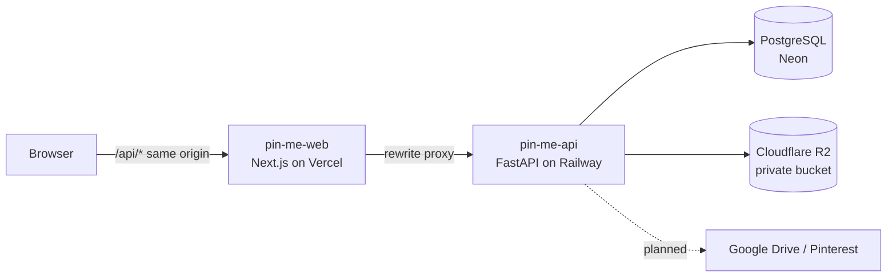

# PinMe API

[](https://github.com/gmorlo/pin-me-api/actions/workflows/ci.yml)

Backend for **PinMe**, a drawing-practice app: artists keep reference boards and run timed, non-repeating practice sessions from their own images.

**Portfolio:** [francke.tech](https://francke.tech) · **Frontend repo:** [pin-me-web](https://github.com/gmorlo/pin-me-web)

> **Live demo is currently offline.** The API host trial ended, so the app runs locally for now. The screenshots below show it running.

<!-- TODO: add docs/images/practice.png (practice screen) and docs/images/boards.png, then uncomment:

-->

## Problem

Artists save references in messy folders and boards, then keep redrawing the same favourites. PinMe turns a board into a practice queue: each image is drawn once, and the board only refills when you decide to reset it.

## What it does

- **Boards** of reference images (create, edit, delete, upload JPEG/PNG/WebP).
- **Timed practice sessions:** pick a board, time per image and image count. The queue is built from images you have not completed yet, with no repeats inside a session.
- **Complete / Skip:** Complete removes the image from the pool, Skip leaves it available for a future session. Sessions can be paused and resumed, and end with a summary (completed, skipped, total time).
- **Reset progress:** makes every image on a board available again while keeping the completion history for future stats.
- **Google sign-in** with an allowlist and a JWT in an HTTP-only cookie.

## Architecture

Production setup used until November 2026 (Vercel + Railway + Neon + R2). The API is not hosted at the moment.



Inside the API the code is layered: `api/` (HTTP routers) → `services/` (domain rules) → `repositories/` (SQLAlchemy) and `storage/` (image source adapters).

## Engineering decisions

1. **Queue built at session start.** The session snapshots a random order of the board's AVAILABLE images into `session_images`. The practice flow then just walks that list, so a reload or a pause never reshuffles or repeats an image.
2. **Completed is not the same as available.** Progress is stored per user and image (`AVAILABLE` / `COMPLETED`), separately from what happened in a session. Skip changes the session only. Reset flips progress back but keeps completion events, which a future activity heatmap will use.
3. **Image sources behind an adapter registry.** Every image has a `source_type`, and an `ImageSource` adapter resolves its bytes. Today that is `LOCAL_UPLOAD` on S3-compatible storage. Google Drive and Pinterest can be added as new adapters without touching board or practice logic.
4. **First-party auth cookie through a proxy.** `vercel.app` and `railway.app` are different sites, so a cookie set directly by the API would be dropped as third-party. The web app proxies `/api/*` to the API, and the cookie lands on the web origin.
5. **Production refuses unsafe config.** Outside `APP_ENV=local` the API will not start with the default `JWT_SECRET`, a secret shorter than 32 characters, or the passwordless dev login enabled.
6. **Images are private.** The R2 bucket is not public. Image bytes are served through `/images/{id}/content`, which checks that the board belongs to the signed-in user.
7. **Cost-aware storage.** Uploads are capped (5 MB per file, 50 images per board, 1,500 per user) because R2 is only a bootstrap. The long-term plan keeps image files on the user's own Drive or Pinterest and stores only metadata and progress here.
8. **Same container locally and in production.** The Dockerfile runs `alembic upgrade head` and then `exec uvicorn`, so migrations apply on deploy and a container stop reaches the server process.

## Tech stack

| Layer | Choice |
|-------|--------|
| Language / framework | Python 3.12, FastAPI, Pydantic v2 |
| Data | SQLAlchemy 2, Alembic, PostgreSQL 16 |
| Storage | S3-compatible: `adobe/s3mock` locally, Cloudflare R2 in production |
| Auth | Google OAuth 2.0, JWT (HTTP-only cookie), email allowlist |
| Tests and quality | Pytest, httpx TestClient, Ruff, GitHub Actions |
| Deploy | Docker, Railway, Neon Postgres |

## Testing

```bash
pip install -r requirements-dev.txt
pytest
```

Tests run without Docker (in-memory SQLite and a fake storage adapter) and cover health, auth (allowlist, cookie, production config guard), boards with uploads and owner-only image access, and the practice flow (queue, Complete/Skip, pause/resume, reset). CI runs them on every push.

## Run locally

```bash
cp .env.example .env
docker compose up -d          # Postgres + S3 mock
pip install -r requirements-dev.txt
alembic upgrade head
uvicorn app.main:app --reload --port 8000
```

OpenAPI docs: `http://127.0.0.1:8000/docs`. Full Windows walkthrough with troubleshooting: [docs/setup.md](docs/setup.md).

## Project structure

```text
app/
├── api/           HTTP routers (auth, boards, images, practice, health)
├── core/          settings, security, constants
├── db/            engine, session, base
├── models/        SQLAlchemy models
├── repositories/  persistence
├── schemas/       Pydantic request/response models
├── services/      domain logic
└── storage/       ImageSource adapters + registry
alembic/           migrations
tests/             Pytest suite
```

## Roadmap

- Resume or discard unfinished sessions from the board view
- Stats endpoint for a GitHub-style activity heatmap
- Google Drive and Pinterest as image sources

## License

Personal portfolio project. License to be decided.
